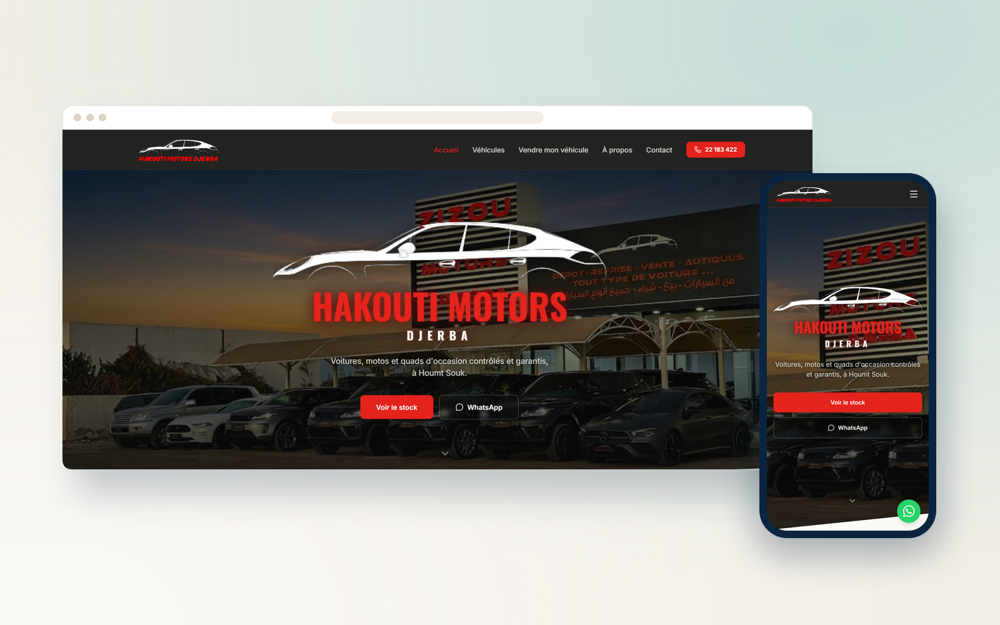
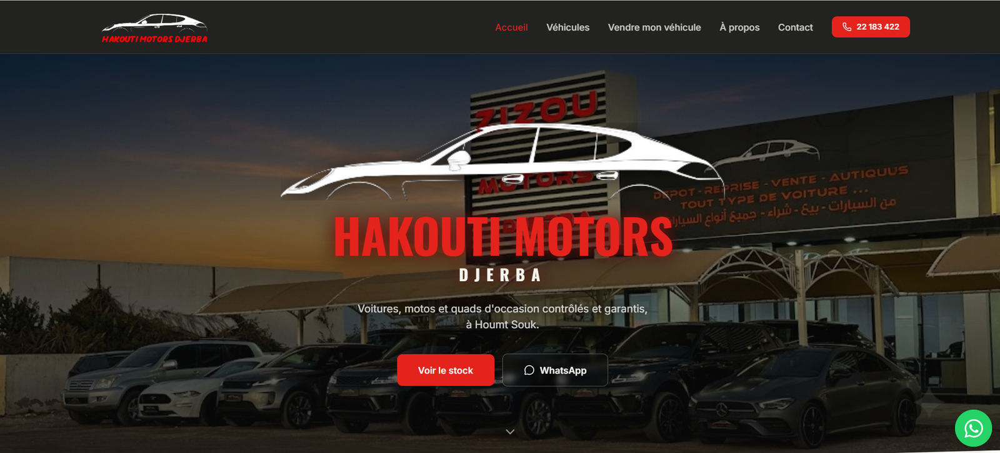
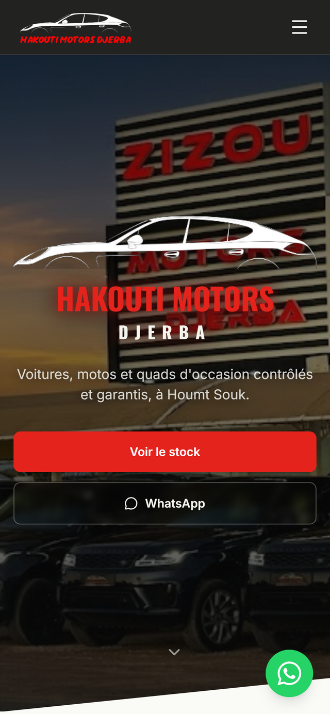

  

<h1 align="center">Hakouti Motors Djerba</h1>

  <b>Site vitrine de concessionnaire automobile, alimenté automatiquement par le feed Instagram du client.</b>
   
  Car dealership website, automatically fed by the client’s Instagram feed.

  
  

  
  
  
  

---

## Le projet

Le concessionnaire publie déjà ses véhicules sur Instagram : plutôt que de lui demander de tout ressaisir, le site se synchronise directement avec son compte. Un workflow n8n interroge l'API Meta Graph à intervalle régulier, récupère les nouvelles publications et met à jour le catalogue du site sans aucune intervention manuelle.

## Fonctionnalités

- Synchronisation automatique du catalogue depuis le feed Instagram
- Workflow n8n planifié interrogeant l’API Meta Graph
- Catalogue de véhicules filtrable, avec galerie photo
- Formulaire de demande d’essai relié directement au commercial
- Site vitrine responsive, optimisé pour la recherche locale à Djerba

## Aperçu

### Ordinateur

### Mobile

  

## Fiche

| | |
|---|---|
| **Type** | Site web |
| **Contexte** | Projet client · Djerba |
| **Année** | 2025 |
| **Rôle** | Conception et développement complets (design, front-end, back-end, mise en ligne) |
| **Technologies** | React · Supabase · n8n · Meta Graph API |
| **Site** | [hakouti-motors-djerba.com](https://hakouti-motors-djerba.com) |

## Code source

> [!NOTE]
> Le code source de ce projet client est privé. Ce dépôt est une vitrine : il présente le projet, ses fonctionnalités et des captures.
> Pour en discuter ou pour un projet similaire : [portfolio](https://satouri-dev.vercel.app/fr) · [LinkedIn](https://www.linkedin.com/in/abdel-monaam-satouri-054268314).

---

  Conçu et développé par <a href="https://satouri-dev.vercel.app/fr">Satouri Développement</a> · Djerba, Tunisie
   
  © 2025 Abdelmonaam Satouri — Tous droits réservés

